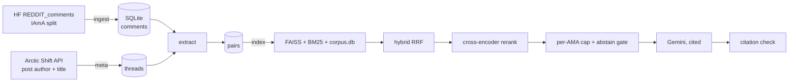

# 🕳️ Reddit RabbitHole RAG — v2

Ask a question, get an answer **cited from real Reddit AMAs** (r/IAmA). Each claim points to the AMA it came from, with a link back to the original comment.

v2 is a rebuild of [v1](https://github.com/athxrvxaa/reddit-rabbithole-rag/tree/v1.0) focused on **scale and measurable quality**:

| | v1 | v2 |
|---|---|---|
| Data | first ~500k comments, streamed once | whole IAmA split, resumable ingest into SQLite |
| Who is the OP? | guessed from comment counts | **true submission author** (Arctic Shift), heuristic only as flagged fallback |
| Q&A cleaning | raw text (HTML entities, quote walls, OP↔OP replies) | unescape, de-quote, bot/OP/follow-up filters, score filter, dedupe, per-thread cap |
| Lexical search | `rank_bm25` (pickle, O(N) Python) | `bm25s` (sparse, saved without pickle) |
| Fusion | 0.3·BM25 + 0.7·cosine (different scales) | Reciprocal Rank Fusion |
| Candidates reranked | 10 | 30 (configurable) |
| Diversity | none (one AMA could fill the results) | max 2 hits per AMA |
| "Not in the AMAs" | LLM decides | cross-encoder score gate **plus** LLM instruction |
| Generation | text cut at 500 chars, uncited | sentence-aware context, `[n]` citations, **validated** after generation, streaming |
| Corpus store | jsonl in RAM | SQLite (memory-light), artifacts hosted on HF Hub |
| Evaluation | 20 questions, one metric | Recall@k / MRR ablation, abstain calibration, citation checks |

## Pipeline



## Quick start (2 minutes, no big downloads)

Uses your old v1 file just to prove everything works end to end. The "hash" embedder is a test stub, **not** for real use.

```bash
python -m venv .venv && source .venv/bin/activate      # Windows: .venv\Scripts\activate
pip install -r requirements-pipeline.txt
python -m rabbithole import-v1 path/to/ama_qa_enriched.jsonl
python -m rabbithole index --embedder hash
RR_USE_RERANKER=0 python -m rabbithole search "what do inmates do all day" --mode hybrid --no-rerank
```

## Real run (full scale)

Run on Kaggle/Colab for the heavy steps — see [docs/KAGGLE.md](docs/KAGGLE.md).

```bash
cp .env.example .env            # add GEMINI_API_KEY (never commit .env)
python -m rabbithole inspect-source --target-rows 5000000   # split size + suggested sample rate
python -m rabbithole ingest --thread-sample-rate 0.05       # resumable; keeps ~5% of threads (whole threads)
python -m rabbithole meta       # real OP + title per thread
python -m rabbithole extract    # clean Q&A pairs
python -m rabbithole stats      # look at the numbers before indexing
python -m rabbithole index      # embeddings (GPU helps) + FAISS + BM25
python app.py                   # http://127.0.0.1:7860
```

Useful commands: `search`, `ask`, `gemini-models`, `upload`. Everything is configurable via env vars (see `rabbithole/config.py`).

## Evaluation (fill in your numbers)

```bash
python -m rabbithole eval-make -n 200        # synthetic questions written by Gemini from sampled pairs
python -m rabbithole eval-retrieval          # ablation table -> eval/results/retrieval.md
python -m rabbithole calibrate               # picks RR_ABSTAIN_THRESHOLD from in/out-of-domain queries
python -m rabbithole eval-generation --judge # citation validity, abstain rates, optional LLM faithfulness
```

Paste your results here after running them (don't ship placeholder numbers):

| Mode | R@1 | R@5 | R@10 | MRR@20 | Latency |
|---|---|---|---|---|---|
| BM25 | | | | | |
| Dense | | | | | |
| Hybrid (RRF) | | | | | |
| Hybrid + rerank | | | | | |

Caveats worth stating: the eval queries are synthetic (written by an LLM from the pair), only the source pair counts as "relevant" so recall is a lower bound (thread-level recall is also reported), and the faithfulness judge is an LLM, ideally a different model from the generator.

## Known limitations

- Data is old Reddit (2009+), so it is anecdotal, dated, and skews toward early-Reddit demographics.
- The OP is "verified" only in the sense that they authored the thread; Reddit's AMA verification is not in this data.
- Categories are keyword heuristics; many AMAs land in `other`.
- Content includes sensitive topics (abuse, addiction, self-harm). The generator is told to treat answers as anecdotes, not advice.
- The abstain threshold is only as good as its calibration set.

## Layout

```
rabbithole/   ingest.py meta.py extract.py indexing.py retrieval.py generation.py pipeline.py eval.py cli.py ...
app.py        Gradio UI (streaming, source cards, topic filter, rate limit)
tests/        24 tests (cleaning, extraction rules, retrieval/RRF/abstain, Gemini client, citations)
eval/         seed queries; results land in eval/results/
deploy/       Hugging Face Space files + helper script
docs/         Kaggle runbook
```
