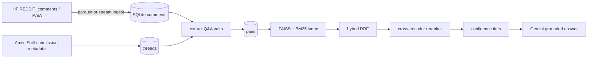

# Reddit RabbitHole RAG v2

Ask a question and get an answer cited from Reddit r/IAmA threads. Claims link to the original comment. AMA posts are personal anecdotes, not verified facts or professional advice.

## Pipeline



## Current corpus

This is the result of one interrupted Kaggle run. The source split has 25,778,822 rows. Its first 20,000 rows span 2009-05-28 through 2009-07-11. Ingest used `--thread-sample-rate 0.19396 --target-rows 6500000`, but was interrupted after about 6.22 million rows were scanned (24%); 915,905 comments were kept. The source is time-ordered, so this corpus covers only the oldest ~24% of the split. Thread ids in the results suggest roughly 2009–2011; exact years must come from `stats` after a full-timeline ingest.

Metadata was requested for 9,710 threads: 9,655 found, 5 missing, and 50 failed in one batch that was not retried in that run. Extraction saw 16,915 threads: 7,205 were too small, 3,798 had no Q&A pairs, and 5,912 had pairs. The result contains 64,600 unique pairs; `op_source` was `submission` for all pairs.

Category distribution: other 28.1%, health_medicine 11.8%, relationships_family 7.7%, education 7.5%, entertainment_media 7.4%, identity_lifestyle 6.3%, crime_law 5.2%, tech 4.6%, jobs_trades 4.0%, business_finance 3.7%, religion 3.6%, gaming_sports 3.0%, military 2.8%, travel_adventure 1.8%, politics_government 1.3%, and science_space 1.3%. Answer length p10/p50/p90 was 109/278/864 characters.

The index contains 64,600 documents with 384-dimensional embeddings and took 76 seconds on a T4. The public artifact upload to `athxrvxaa/rabbithole-artifacts` was 284 MB; the private ingest checkpoint at `athxrvxaa/rabbithole-checkpoints` was 280 MB.

## Preliminary retrieval results

**Preliminary, n=39 synthetic queries, approximately ±15 percentage points of uncertainty, not enough to rank modes.** These values are from the completed run; they are not a stable comparison. `latency` is the reported mean/p95 in milliseconds.

| Mode | R@1 | R@5 | R@10 | R@20 | MRR@20 | Thread R@5 | Latency ms (mean / p95) |
|---|---:|---:|---:|---:|---:|---:|---:|
| BM25 | .308 | .615 | .641 | .667 | .436 | .667 | 4 / 3 |
| Dense | .462 | .641 | .744 | .821 | .555 | .769 | 28 / 22 |
| Hybrid | .513 | .667 | .692 | .744 | .573 | .718 | 23 / 26 |
| Hybrid + rerank | .615 | .692 | .769 | .769 | .653 | .795 | 100 / 119 |

The query set is synthetic, and only the source pair counts as pair-level relevant. Thread-level recall is also reported. New eval runs show 95% intervals; overlapping intervals mean the sample does not support naming a winner.

## Run locally

Python 3.10–3.13 is supported. On Windows, run `./run_local.ps1` from PowerShell. It creates `.venv`, installs the app dependencies, downloads the public runtime artifacts on first start, and serves the app at <http://127.0.0.1:7860/>. Keep the window open while using the app. To skip dependency installation, run `./run_local.ps1 -SkipInstall`.

Set `GRADIO_SERVER_PORT` before launch to choose another port (for example, `$env:GRADIO_SERVER_PORT = "7861"` in PowerShell). If the configured port is occupied, Gradio searches for an available port automatically.

The public index is configured by default. Copy `.env.example` to `.env` and add a valid `GEMINI_API_KEY` for generated answers. Gemini 3.8 Flash is the default answer model and uses low thinking for faster responses; override it with `GEMINI_MODEL` if needed. Without an API key, retrieval can load but answer generation reports a missing Gemini configuration. Never commit `.env`.

For pipeline development, install the full dependency set and configure keys in `.env`:

```bash
python -m venv .venv
# Activate the environment using your shell's command.
pip install -r requirements-pipeline.txt
python -m rabbithole inspect-source --target-rows 6500000
python -m rabbithole ingest --method parquet --thread-sample-rate 0.19396 --target-rows 6500000
python -m rabbithole meta
python -m rabbithole extract
python -m rabbithole stats
python -m rabbithole index
python -m rabbithole search "What is the hardest part of being a nurse?"
python -m rabbithole ask "What is the hardest part of being a nurse?"
```

`ingest --method parquet` is the default and resumes by completed shard; `--method stream` is the fallback. Parquet ingest needs `pyarrow` from `requirements-pipeline.txt`. Both methods use deterministic whole-thread sampling. Keep the same `--thread-sample-rate` when resuming. `inspect-source` measures actual throughput on its sample and estimates full-scan time from that speed. The HF IAmA split is time-ordered: use a full thread-sampled scan for timeline coverage. Interrupting an early scan leaves only its oldest slice.

`stats` prints pair counts by year, the minimum and maximum years, and warns when the data spans less than three years. The index manifest stores its year bounds; the app header displays them as “threads from YYYY–YYYY.”

## Confidence and calibration

Reranker scores depend on the reranker model. `RR_ABSTAIN_THRESHOLD` is the hard-abstain threshold (default `-5.0`): below it, skip Gemini. `RR_LOWCONF_THRESHOLD` (default `-1.0`) marks a result low confidence while still allowing an answer. Between the thresholds, retrieval does not hard-abstain and Gemini's grounded “not covered” instruction decides whether to answer. The app and CLI show a low-confidence note.

The earlier single-threshold setting incorrectly hard-abstained the nurse query even though all four retrieved hits were nurse AMAs. The two-tier gate addresses that behavior. Calibrate thresholds for the deployed reranker: `python -m rabbithole calibrate` prints in-domain pass and OOD abstain rates, recommends the highest threshold with at least a 95% in-domain pass rate, and saves `eval/results/calibration.json` with the reranker name. Thresholds remain calibrated on a small seed set; rerun calibration when changing the reranker or corpus.

The ms-marco reranker also once ranked a prison-painting hypothetical highly for a question about daily prison life, showing that lexical overlap can mislead. Retrieval evaluation and manual review remain necessary.

## Evaluation and Gemini quota handling

```bash
python -m rabbithole eval-make -n 200 --sleep 6.5 --model gemini-flash-lite-latest
python -m rabbithole eval-retrieval
python -m rabbithole eval-retrieval --reranker cross-encoder/ms-marco-MiniLM-L-12-v2
python -m rabbithole eval-retrieval --reranker BAAI/bge-reranker-base --sweep
python -m rabbithole calibrate
python -m rabbithole eval-generation --judge --judge-model gemini-flash-lite-latest
```

`eval-make` appends to its output and skips source indices already saved, so it can resume across runs. It warns when fewer than 200 eligible source rows exist. `--sleep` sets the request delay; `--model` selects the query-generation model. `eval-generation` supports `--limit`, `--sleep`, and `--judge-model`, saves partial rows on quota exhaustion, and reports completed query count.

Gemini 429 responses are inspected for minute/day quota details. Per-minute quota waits for the reported retry delay (capped at 60 seconds); daily quota and exhausted retries move immediately to the next model. If all configured models run out of quota, the client raises `GeminiQuotaError`. Default `GEMINI_FALLBACK_MODELS` is `gemini-2.5-flash,gemini-flash-lite-latest`.

Retrieval evaluation reports n and 95% intervals for Recall@k and MRR, saves per-query ranks to `eval/results/retrieval_per_query.jsonl`, and warns when intervals overlap. `--reranker NAME` can be repeated to compare models. `--sweep` compares dense RRF weights 1, 1.5, 2, and 3 against `RR_RERANK_N` values 30, 50, and 100; it leaves defaults unchanged. Results at this preliminary scale should not guide configuration decisions; use at least 300 queries.

RRF settings are `RR_RRF_DENSE_WEIGHT` and `RR_RRF_BM25_WEIGHT` (both default `1.0`). Other retrieval settings and model ids are in `rabbithole/config.py` and `.env.example`.

## Limitations

- This build covers only the oldest ~24% of the time-ordered IAmA split; thread ids suggest 2009–2011. **TODO(after full-timeline ingest): replace with exact years from stats**.
- Generation quality has not been evaluated end to end because Gemini free-tier quota errors stopped eval-make/eval-generation in the completed run.
- Abstain thresholds are reranker-specific and were previously mis-set; the two-tier fix is described above. The current calibration seed set is small.
- AMA posts are dated personal anecdotes, not verified claims or professional advice. “Verified OP” means the submission author was matched, not that Reddit verified the AMA.
- Categories are keyword heuristics; many pairs can be classified as `other`.
- The corpus contains sensitive topics, including abuse, addiction, and self-harm.

See [docs/KAGGLE.md](docs/KAGGLE.md) and [notebooks/kaggle_run.ipynb](notebooks/kaggle_run.ipynb) for the Kaggle workflow.
